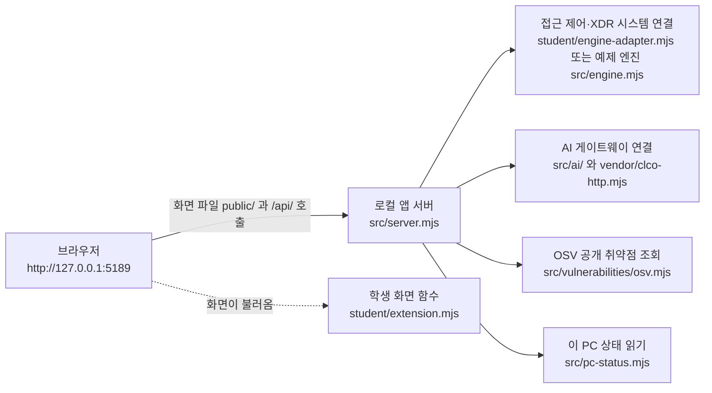

# 튀김면 보안 Agent 학생용 실행 설명서

작성: 학생(Won-22), 2026-11-16. 시작 틀 버전 0.2.21(`package.json`)을 기준으로 씁니다.
제공 문서(`README.md`, `docs/STUDENT_LAUNCH_GUIDE.md` 등)는 고치지 않았고, 이 문서는 학생이 직접 쓴 별도 문서입니다.

## 0. 이 문서에서 쓰는 표시

실제로 확인한 것과 문서·코드만 읽은 것을 섞어 쓰지 않으려고 근거를 세 가지로 나눕니다.

| 표시 | 뜻 |
|---|---|
| 실제 확인 | 이 PC에서 직접 실행하거나 화면·출력으로 본 것 |
| 문서 근거 | 제공 문서나 제공 코드에 적힌 내용을 읽은 것. 이 PC에서 직접 실행하지는 않았음 |
| 미확인 | 확인하지 못한 것. 동작한다고 적지 않음 |

## 1. 목적과 기능

- **목적:** 회사 직원이 자기 로그인 상태, 업무 앱 접속 결과, 최근 접속 기록과 보안 경보를 한 화면에서 보는 보안 Agent(앱 이름 `튀김면`, 시작 틀의 기본 이름은 케셰브)입니다. 13~22단계에서 한 프로젝트를 이어서 완성합니다. (문서 근거: `README.md`)
- **기능(학생이 `student/extension.mjs`에 구현한 화면):**
  로그인 사용자·기기·세션 표시, 업무 앱 접근 판정과 이유, 접속 기록과 XDR 경보 목록·필터·상세, 기기·세션·알림·도움정보 상태, AI 연결 점검 결과, 근거에 연결된 AI 사건 설명, 보안 조치 요청 상태, 설치 패키지와 알려진 취약점(OSV) 조회 결과.
- **하지 않는 것:** 악성코드 검사나 치료, 실제 보안 조치 집행, 전체 직원의 이력 조회, 실시간 전체 위협 탐지는 하지 않습니다. 조회 범위는 본인의 최근 40건입니다. (문서 근거: 단계 안내)

## 2. 지원 환경과 버전

| 항목 | 값 | 근거 |
|---|---|---|
| 앱(시작 틀) 버전 | 0.2.21 | 실제 확인: `package.json`의 `version` |
| Node.js | 수업 기준 24.19.0, 실행 도구는 22~24 허용 | 실제 확인: `package.json`의 `engines`, `tools/start-alekov.ps1`의 버전 검사 |
| Node.js 25 이상 | 실행 도구가 멈춤(지원하지 않음) | 실제 확인: v26.8.1에서 "앱은 Node.js 22~24 에서 실행합니다" 메시지가 나오며 앱이 켜지지 않았음 |
| 외부 npm 의존성 | 없음(`package.json`에 `dependencies` 없음) | 실제 확인 |
| 운영체제 | Windows 11 Pro 10.0.26200, Windows PowerShell 5.1 | 실제 확인: 이 PC |
| 브라우저 | PC 브라우저(`http://127.0.0.1:5189`를 엶) | 실제 확인: 화면 캡처상 Microsoft Edge로 보이는 브라우저에서 화면이 열림 |
| 다른 운영체제·브라우저 | — | 미확인 |

## 3. 폴더 구조

작업 위치는 두 곳입니다. **앱 폴더**와 **Git 최상위 폴더**가 다릅니다.

```text
<프로젝트 폴더>\                                                   ← Git 최상위 폴더(커밋·push는 여기서)
                                                                   (이 PC의 예: 워크벤치가 만든 ...\projects\방어전)
└─ on-client\                                                    ← 앱 폴더(앱 실행은 여기서)
   ├─ README.md, package.json, .env.example                      (제공)
   ├─ docs\STUDENT_RUNBOOK.md                                    (학생 작성, 이 문서)
   ├─ docs\ 나머지                                               (제공 문서)
   ├─ student\extension.mjs                                      (학생 작성: 화면 함수 8개)
   ├─ student\engine-adapter.mjs                                 (제공 틀, 수정하지 않음)
   ├─ public\index.html, app.js, style.css, *-view.mjs, assets\  (제공 화면)
   ├─ src\server.mjs 와 src\ 하위 폴더                           (제공 앱 서버)
   ├─ tools\start-alekov.ps1 외                                  (제공 실행·포장 도구)
   └─ vendor\clco-http.mjs                                       (제공 AI 연결 코드)
```

(실제 확인: 폴더를 직접 열어 본 목록입니다.)

## 4. 시스템 구성도

그림 파일 없이 글로만 적습니다. 같은 내용을 Mermaid, ASCII, 표로 세 번 적었습니다.

### 4.1 Mermaid



### 4.2 ASCII

```text
[브라우저] --화면 파일, /api/ 호출--> [로컬 앱 서버 src/server.mjs]
    |  (화면이 student/extension.mjs 를 불러와 8개 칸을 그림)
    v                                   |
[학생 화면 함수 8개]                    +--> [접근 제어·XDR 시스템 연결]  기본 상태: 연결 없음
                                        +--> [AI 게이트웨이 연결]         기본 상태: 권한 준비 중
                                        +--> [OSV 공개 취약점 조회]       허용 목록이 비면 외부 조회 안 함
                                        +--> [이 PC 상태 읽기]
```

### 4.3 표

| 구성 요소 | 실제 파일·주소 | 하는 일 | 이 PC에서의 상태 |
|---|---|---|---|
| 브라우저 | `http://127.0.0.1:5189` | 화면을 보여 주고 서버 `/api/` 를 부름 | 실제 확인: 화면이 열림 |
| 제공 화면 | `public/index.html`, `public/app.js` | 메뉴·제공 카드·학생 칸을 그림. 학생 함수를 `/student/extension.mjs` 로 불러옴 | 실제 확인 |
| 학생 화면 함수 | `student/extension.mjs` | 학생 칸 8개의 내용을 만듦 | 실제 확인: 예제 모드 화면에서 표시됨 |
| 로컬 앱 서버 | `src/server.mjs` | 브라우저 요청을 받아 아래 연결로 전달 | 실제 확인: 기본 모드와 예제 모드 모두 응답 |
| 접근 제어·XDR 연결 | `student/engine-adapter.mjs`, 예제용 `src/engine.mjs` | 사용자·앱·기록·판정을 읽음 | 기본 실행은 연결 없음(실제 확인), 실제 연결은 미확인 |
| AI 게이트웨이 | `src/ai/`, `vendor/clco-http.mjs` | 앱 서버를 거쳐서만 AI에 연결 | 예제 모드에서 권한 준비 중(`ON_AI_PROVISIONING_PENDING`, 실제 확인), 연결 완료는 미확인 |
| OSV 조회 | `src/vulnerabilities/osv.mjs` | 허용 목록에 있는 공개 패키지만 조회 | 예제 모드에서 `PROJECT_NOT_CONFIGURED`(실제 확인), 실제 조회는 미확인 |

서버가 제공하는 `/api/` 경로(문서 근거: `src/server.mjs`와 `public/app.js`를 읽음):
`/api/me`, `/api/apps`, `/api/events`, `/api/devices`, `/api/sessions`, `/api/access`, `/api/diagnostics`, `/api/ai/check`, `/api/ai/explain`, `/api/actions/prepare`, `/api/actions/execute`, `/api/actions/result`, `/api/vulnerabilities`, `/api/pc/status`, `/api/learner-support`, `/api/learner-support/gpt`, `/api/native-login/`.
학생 코드는 이 주소를 직접 호출하지 않고 제공 화면이 넘겨 주는 값만 받습니다.

## 5. 실행 절차

### 5.1 준비

1. Node.js 22~24(수업 기준 24.19.0)가 필요합니다.
2. PowerShell에서 `node --version` 으로 버전을 봅니다. v25 이상이면 5.4의 방법으로 Node 24를 따로 씁니다.

### 5.2 PowerShell을 여는 위치

- **앱 실행은 `on-client` 폴더에서 합니다.** 파일 탐색기에서 `on-client` 를 열고 주소 표시줄에 `powershell` 을 입력한 뒤 Enter를 누릅니다. 프롬프트 끝이 `...\방어전\on-client>` 여야 합니다.
- 한 단계 위(`...\방어전>`)에서 실행하면 `.\tools\start-alekov.ps1` 파일을 찾지 못해 "-File 매개 변수에 대한 인수 ... 없습니다" 오류가 납니다. (실제 확인)

### 5.3 실행 명령

**먼저 `node --version` 으로 Node가 v22~v24인지 확인합니다.** v25 이상이면 이 명령은 아래 오류로 멈추므로, 5.4의 한 줄을 같은 창에서 먼저 실행한 뒤 이 명령을 실행합니다.

```powershell
powershell -NoProfile -ExecutionPolicy Bypass -File .\tools\start-alekov.ps1
```

- 정상 시작 신호(실제 확인: 새 PowerShell 창에서 5.4를 먼저 한 뒤 실행한 출력 화면):
  ```text
  계정 연결 준비가 끝났습니다. 앱에서 확인 번호로 로그인·승인을 진행하세요.
  케셰브 연결 확인: http://127.0.0.1:5189
  케셰브가 켜졌습니다. 브라우저에서 http://127.0.0.1:5189/ 을 여세요.
  서버가 응답한 것만 확인했습니다. AI 연결 상태는 화면에서 따로 확인해 주세요.
  끄려면 이 창에서 Ctrl+C 를 누르세요.
  ```
  첫 줄은 오류가 아니라 계정 연결 준비가 끝났다는 안내입니다. 네 번째 줄대로 이 신호는 서버가 응답했다는 뜻일 뿐, AI 연결이 되었다는 뜻이 아닙니다.
- Node 버전이 맞지 않을 때 같은 첫 줄 뒤에 노란 글씨 "지금 Node.js 는 v26.8.1 입니다. 앱은 Node.js 22~24 에서 실행합니다. Node.js 24.19.0 을 권장합니다."가 나오고 앱은 켜지지 않습니다. (실제 확인)
- 브라우저에서 `http://127.0.0.1:5189` 를 엽니다. 위쪽 상태 표시와 「보호 현황」 화면이 보이면 정상입니다. (실제 확인: 화면이 열렸고, 실제 연결이 없는 기본 상태라 "연결 없음"이 보임)
- 이 실행 도구는 프로그램 설치, 전역 설정 변경, 다른 프로그램 종료를 하지 않습니다. (문서 근거: 도구 머리말)

선택 옵션(문서 근거): `-Port 5190`(포트 변경, 이때 브라우저 주소도 `:5190`), `-Background`(창 없이 실행).

### 5.4 Node 24가 따로 필요할 때(이 PC에서 쓴 방법)

이 PC의 Node는 v26.8.1이라 실행 도구가 멈췄습니다(실제 확인). 공식 사이트(`https://nodejs.org/dist/v24.19.0/`)의 Windows x64 압축 파일을 받아 `SHASUMS256.txt` 와 SHA-256이 같은 것을 확인한 뒤 원하는 폴더에 풀어서 썼습니다(이 PC에서는 `C:\node24`, 이 위치는 필수가 아님). 이 PowerShell 창에서만 먼저 쓰게 하는 한 줄입니다. 창을 닫으면 원래대로 돌아갑니다.

```powershell
$env:Path = "<Node 24를 푼 폴더>;" + $env:Path
```

(`<Node 24를 푼 폴더>` 는 `node.exe` 가 들어 있는 폴더입니다.)

`node --version` 이 `v24.19.0` 이 나오면 5.3의 명령을 실행합니다.

(실제 확인: 새 PowerShell 창에서 ① 5.3의 명령이 v26.8.1 오류로 멈춤 → ② 위 한 줄 실행 → ③ `node --version` 이 `v24.19.0` → ④ 5.3의 명령이 정상 시작 신호를 출력하고 `http://127.0.0.1:5189` 에서 화면이 열림. 사용자 PC의 화면 캡처 두 장으로 확인)

### 5.5 예제 모드로 켜기(학생 화면 시험용)

예제 모드는 연습용 가짜 자료를 보여 줄 뿐 실제 연결이나 성취가 아닙니다. (문서 근거: `README.md`)

```powershell
$env:ON_PORT = "5190"; node src/server.mjs --demo
```

(실제 확인: 포트 5190에서 켜지고 학생 칸 8개가 표시됨. `npm run demo`·`npm start` 로 켜는 방법은 이 PC에서 실행하지 않아 미확인)

### 5.6 종료와 재실행

- 종료: 앱을 켠 PowerShell 창에서 `Ctrl+C` 를 누릅니다. (실제 확인: 실행 도구가 "끄려면 이 창에서 Ctrl+C 를 누르세요"라고 출력했고, 실제로 `Ctrl+C` 를 누르자 앱이 꺼졌으며 브라우저에서 페이지를 새로 고치면 접속되지 않았음) `-Background` 로 켰다면 작업 관리자에서 해당 `node` 프로세스를 종료합니다. (문서 근거, 미확인)
- 재실행: 같은 폴더에서 같은 명령을 다시 실행합니다. 포트가 사용 중이면 `-Port 5190` 을 붙입니다. (문서 근거)

## 6. 학생이 만든 것과 제공 코드의 경계

| 구분 | 파일 | 비고 |
|---|---|---|
| 학생 작성 | `student/extension.mjs`, `docs/STUDENT_RUNBOOK.md` | 이 두 파일만 학생이 고침 |
| 제공(수정 안 함) | `public/*`, `src/*`, `tools/*`, `vendor/*`, `student/engine-adapter.mjs`, 나머지 `docs/*`, `README.md`, `.env.example`, `package.json` | 제공 서버·화면·판정 코드·인증 설정은 고치지 않음 |

### 6.1 구현한 함수와 확인 상태

`student/extension.mjs` 가 내보내는 `createStudentView()` 가 아래 함수 8개를 돌려줍니다. 각 함수는 입력값만 읽어 DOM 요소 하나를 만들고 이전 값을 보관하지 않습니다. `createElement` 와 `textContent` 만 쓰고 `innerHTML` 은 쓰지 않습니다. (실제 확인: 소스 검색 결과 `innerHTML` 0건)

| 단계 | 함수 | 받는 값 | 보여 주는 것 | 확인 상태 |
|---|---|---|---|---|
| 13 | `renderIdentity` | `{ me, devices, sessions }` | 사용자·현재 기기·세션과 기기·세션 목록. 비정상 상태는 "주의:" 글자로 구분 | 모의 입력 점검 + 예제 화면 확인 |
| 14 | `renderDecision` | `{ status, mode, data, error, appId }` | 허용·거부·추가 확인 필요·확인 불가와 이유·시각. 요청 실패는 거부와 구분 | 모의 입력 점검 + 예제 화면 확인(허용·거부·추가 확인 필요) |
| 15 | `renderEvents` | `{ status, mode, data, error }` | 최신순 기록 목록, 필터 3개, 상세(근거·규칙·세 상태) | 모의 입력 점검 + 예제 화면 확인(기록 1건) |
| 16 | `renderStatus` | `{ devices, sessions, notifications, diagnostics, mode }` | 불러오는 중·빈 목록·실패 구분, 알림, 도움정보와 「도움정보 복사」 버튼 | 모의 입력 점검 + 예제 화면 확인 + 복사 결과 직접 확인 |
| 16 | `renderEvents` 상세의 미지원 조치 | 기록의 `supportedActions` | 있을 때만 `<action> 미지원` 비활성 버튼 | 모의 입력 점검만. 실제 기록에는 지원 조치가 없어 화면에서는 미확인 |
| 17 | `renderAiConnection` | `{ status, mode, data, error, checkedAt, explanationAccepted }` | 점검 전·중·결과, 오류 원인별 안내. 사건 설명은 아직 실행하지 않았다고 적음 | 모의 입력 점검 + 예제 화면 확인(권한 준비 중) |
| 18 | `renderExplanation` | `{ event, explanation, checkedAt }` | 근거 ID·근거 글·규칙·확인 불가 상태·제안. 근거가 맞지 않으면 쓰지 않음 | 모의 입력 점검만. 실제 설명 성공 화면은 미확인 |
| 19 | `renderAction` | `{ status, event, actionId, target, receipt, observation, message, ... }` | 11개 상태별 문장. `effectApplied === true` 일 때만 효과 확인 | 모의 입력 점검 + 처음 상태 화면 확인. 실제 집행 상태는 미확인 |
| 20 | `renderVulnerabilities` | `{ status, mode, data, error }` | 조회 상태, lockfile 값, 패키지별 정확한 버전·취약점 ID·수정 시각 | 모의 입력 점검 + 예제 화면 확인(조회 준비 미완료) |

모의 입력 점검 스크립트는 이 프로젝트에 포함하지 않았습니다. 그래서 모의 입력 결과를 다른 사람이 같은 방법으로 다시 확인할 수는 없습니다.

## 7. 오류별 확인 순서

| 증상 | 원인 | 확인 | 복구 | 근거 |
|---|---|---|---|---|
| `지금 Node.js 는 vXX 입니다` | Node가 22~24 범위가 아님 | `node --version` | 5.4 방법 또는 Node 24.19.0 설치 후 새 창에서 실행 | 실제 확인(v26.8.1) |
| `-File 매개 변수에 대한 인수 ... 없습니다` | 앱 폴더가 아닌 곳에서 실행 | 프롬프트 끝이 `...\on-client>` 인지 | `on-client` 로 이동 | 실제 확인 |
| `포트 5189 를 다른 프로그램이 쓰고 있습니다` | 포트 사용 중 | 다른 프로그램은 끄지 않음 | `-Port 5190` | 문서 근거 |
| 화면의 "연결 없음", `ENGINE_NOT_CONNECTED` | 기존 서버·에이전트 연결 어댑터 없음(기본 실행) | 화면 위쪽 상태 표시 | 연결은 담당자 안내가 있을 때만. 예제 모드로 학생 화면 확인 | 실제 확인 |
| `ON_AI_PROVISIONING_PENDING`(권한 준비 중) | 운영 측 계정·앱 권한 준비 전 | AI 연결 점검의 코드 | 담당자에게 계정 연결과 앱 권한 확인 요청. 학생 잘못이 아님 | 실제 확인(예제 모드) |
| `PROJECT_NOT_CONFIGURED`(패키지 조회) | 조회 대상 프로젝트·허용 패키지 설정 없음 | 학생 칸의 "조회 준비 미완료(not_configured)" | 운영자 준비 사항. 학생이 의존성을 낮추거나 설정을 바꾸지 않음 | 실제 확인(예제 모드) |
| `NETWORK_ERROR`, `TIMEOUT`, `CANCELLED`, `INVALID_RESPONSE` | 앱 서버가 꺼짐, 응답 지연, 취소, 응답 형식 불일치 | 앱을 켠 PowerShell 창이 살아 있는지 | 앱을 다시 켜고 화면의 다시 불러오기를 직접 누름(자동 재요청 없음) | 문서 근거: `public/app.js`를 읽음. 실제 확인: 앱을 끈 뒤 페이지를 새로 고치면 브라우저가 접속하지 못함. 이미 열려 있는 화면에서 다시 불러오기를 눌렀을 때 학생 칸에 보이는 문구는 미확인 |
| 도움정보 복사가 안 됨 | 브라우저 클립보드 권한 | 학생 칸의 "복사하지 못했습니다" 문구 | 표시된 내용을 직접 선택해 복사 | 실제 확인: 사용자 브라우저에서는 복사됨, 내장 브라우저에서는 실패 안내가 나옴 |
| 커밋 안내문이 "경로에 잘못된 문자가 있습니다"로 멈춤 | 한글 폴더 경로와 PowerShell 출력 인코딩 | 같은 창에서 인코딩 설정 | `[Console]::OutputEncoding = [System.Text.Encoding]::UTF8` 실행 뒤 안내문을 다시 실행 | 실제 확인: 설정 뒤 정상 실행 |
| 제출 결과가 "저장소나 커밋을 받지 못했습니다(확인 불가)" | 커밋을 `git push` 하지 않음 | GitHub 저장소에 그 커밋이 보이는지 | `git push` 뒤 같은 커밋으로 다시 제출 | 실제 확인: 15단계와 20단계에서 발생, push 뒤 해결 방향 |

도움정보는 앱의 「도움정보」 칸이나 학생 칸의 「도움정보 복사」로 만듭니다. 학생 칸은 요청 ID·구성 요소·버전·확인 시각·엔진 모드·엔진 코드 여섯 줄만 복사하며 비밀값은 없습니다. (실제 확인: 복사한 내용을 직접 읽어 봄)

## 8. 확인하지 못한 기능(미확인)

아래는 동작한다고 적지 않습니다.

- 실제 회사 시스템(SDP) 연결과 실제 사용자·기기·세션·기록 값. 기본 실행은 연결이 없습니다.
- 계정 연결 승인과 AI 연결 승인의 끝까지의 흐름, AI 연결 완료(`ok`) 화면.
- 실제 AI 사건 설명 성공 화면과 설명의 근거 ID가 기록과 일치하는지의 실화면 확인.
- 실제 보안 조치 준비·집행·결과 재조회. 지금 기록에는 연동 시스템이 지원하는 조치가 없어 조치 준비 버튼이 나오지 않는 것이 정상입니다.
- 실제 패키지 OSV 조회(`complete`, `partial`). 외부 npm 의존성이 없고 허용 목록도 비어 있습니다.
- 앱 서버를 끈 상태의 실패 화면과 키보드(Tab, Enter) 조작 전체.
- Windows 외 운영체제, Edge 외 브라우저, `npm start`·`npm run demo`·`-Background` 실행.

## 9. 비밀 정보와 제출

- `.env.example` 에는 비밀 없는 설정(`ON_PORT`, `ON_ENGINE_ADAPTER`, `ON_AI_MODEL`, `ON_PROJECT_DIRECTORY`, `ON_APPROVED_PUBLIC_PACKAGES`)만 있습니다. (실제 확인)
- 키·토큰·비밀번호는 코드·문서·커밋·도움정보에 적지 않습니다. 이 문서에도 없습니다.
- 현재 Git 저장소에는 `.gitignore` 가 **없고** `.env` 파일도 없습니다. (실제 확인: `git ls-files` 에 `.env.example` 외 비밀 이름의 파일 없음) 비밀 설정 파일 `.env` 를 만들기 전에 먼저 `.gitignore` 에 `.env` 를 등록해야 커밋에서 빠집니다.
- 제출: `방어전` 폴더에서 커밋 안내문(단계 번호 입력)을 실행하고 `git push` 한 뒤, 과제 화면에 저장소 주소 `https://github.com/Won-22/safety` 와 40자리 커밋을 입력합니다. 저장소가 공개라서 비공개 원문 묶음은 쓰지 않습니다. (실제 확인: 13~20단계 커밋 확인. 21단계 제출 결과는 미확인)
